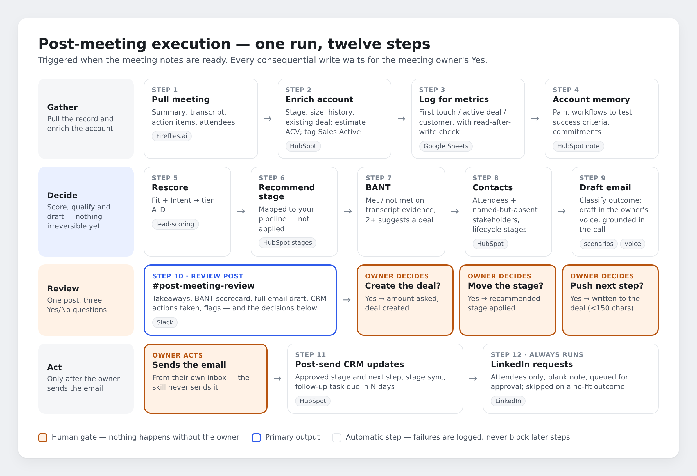
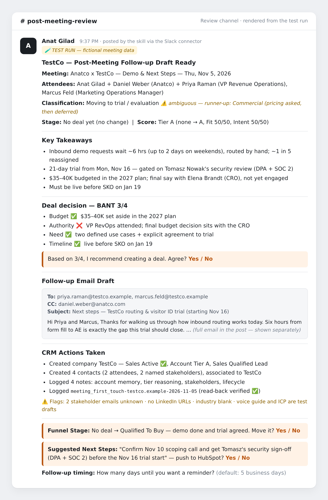
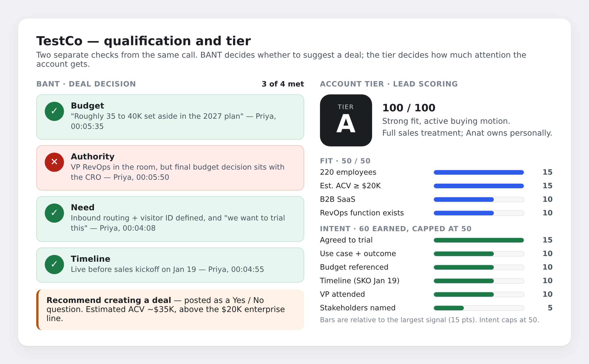
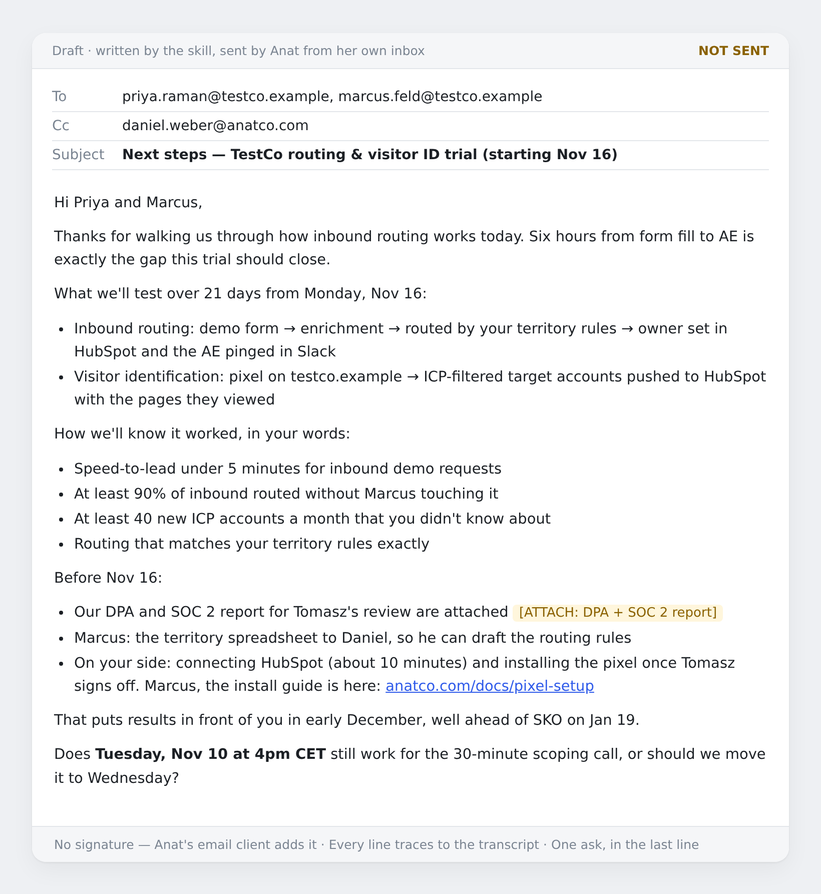

# post-meeting-execution

A set of four Claude skills that turn every sales meeting into its follow-through: the transcript is read, the outcome classified, the account rescored, the CRM updated, and a ready-to-send follow-up drafted in the meeting owner's voice — all posted to one Slack review channel where the owner answers three Yes/No questions.

**Human approval gates every consequential action.** The skill never sends the email, never creates a deal without a Yes, and never moves a deal stage on its own.

---

## What's in this repo

| Path | What it is |
| --- | --- |
| [`skills/post-meeting-execution/`](skills/post-meeting-execution/) | The main skill: the 12-step workflow, plus a setup and customization checklist in `references/` |
| [`skills/anatco-followup-scenarios/`](skills/anatco-followup-scenarios/) | Sub-skill: 9 meeting-outcome categories, classification rules, and an email framework for each |
| [`skills/anatco-voice-guide/`](skills/anatco-voice-guide/) | Sub-skill: how the meeting owner writes — tone, greeting, formatting, link rules |
| [`skills/anatco-lead-scoring/`](skills/anatco-lead-scoring/) | Sub-skill: Fit + Intent scoring into tiers A–D |
| [`dist/`](dist/) | Each skill packaged as a ZIP, ready to upload to Claude |
| [`examples/testco-test-run/`](examples/testco-test-run/) | A full test run on a fictional demo call: the input notes and everything the skills produced |
| [`assets/`](assets/) | Diagrams and renders used in these READMEs |

## See it in action

The [TestCo test run](examples/testco-test-run/) walks through one complete execution on a fictional 30-minute demo call. Here's the review post it produced in Slack:

| Qualification and tier | Follow-up email draft |
| --- | --- |
|  |  |

## How it's configured

This version is set up for a test environment:

| Setting | Value |
| --- | --- |
| Meeting-notes tool | Fireflies.ai |
| CRM | HubSpot — default "Sales Pipeline" stages, plus two custom company properties: `sales_active` (checkbox) and `account_tier` (dropdown A/B/C/D) |
| Review channel | Slack `#post-meeting-review` |
| Metrics log | A Google Sheet with columns `event_id, event_type, domain, company, meeting_date, external_attendees` |
| Enterprise ACV threshold | $20K |

The full configuration is at the top of [`skills/post-meeting-execution/SKILL.md`](skills/post-meeting-execution/SKILL.md).

> **Test drafts.** The voice guide and the ideal customer profile in the lead-scoring skill are best guesses, written for testing. Replace them with patterns from real emails and real won/lost deals before relying on them.

## Install in Claude

1. Download the four ZIPs from [`dist/`](dist/).
2. In `post-meeting-execution`, replace `YOUR_SPREADSHEET_ID` in `SKILL.md` with the ID from your Google Sheet's URL, then re-zip the folder (with `SKILL.md` directly inside it). Adjust the other configuration values to your own stack.
3. In Claude, go to **Settings → Skills**, upload each ZIP as it is, and make sure each one is toggled on. Code execution and file creation must be enabled.
4. Connect the tools the skill uses: HubSpot, Slack, Google Sheets, and your meeting-notes tool. LinkedIn is optional; Step 12 is skipped without it.
5. In HubSpot, create the `sales_active` and `account_tier` company properties.

Then give Claude a meeting's notes and ask it to run the post-meeting workflow.

## Credits

The main `post-meeting-execution` skill is from Jeremy Hurst's folder in [swan-gtm/gtm-skills](https://github.com/swan-gtm/gtm-skills/tree/main/skills/jeremy-hurst/post-meeting-execution), used under the MIT License (© 2026 Swan). Changes in this repo: the template placeholders are filled with a test configuration, the Step 6 stage table is mapped to HubSpot's default pipeline, and the trial-stage warning is replaced with a note (as the original checklist directs when no trial stage exists). The three sub-skills and the example are new.

Released under the [MIT License](LICENSE).
