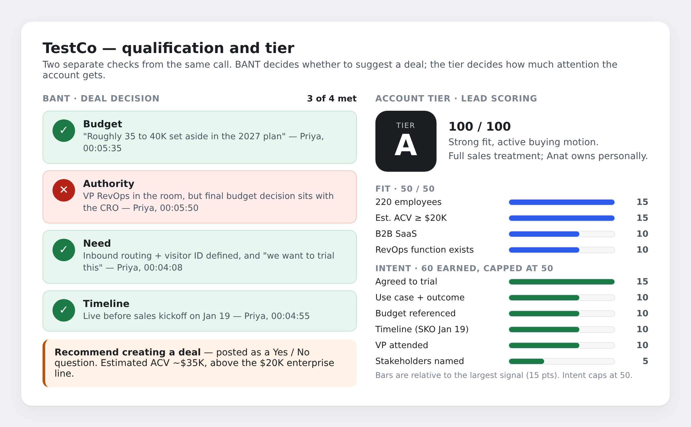
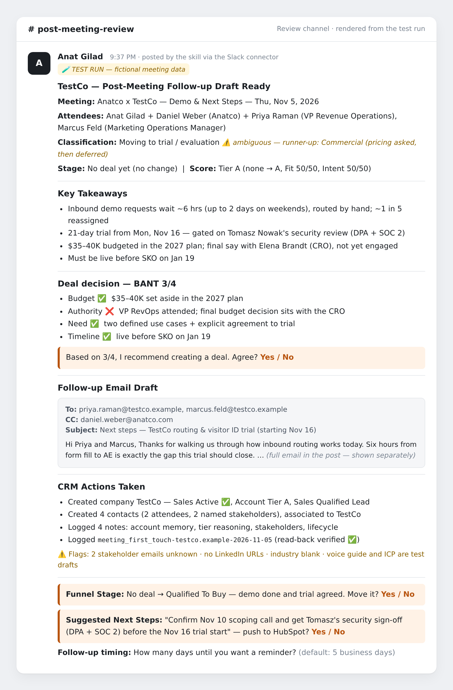
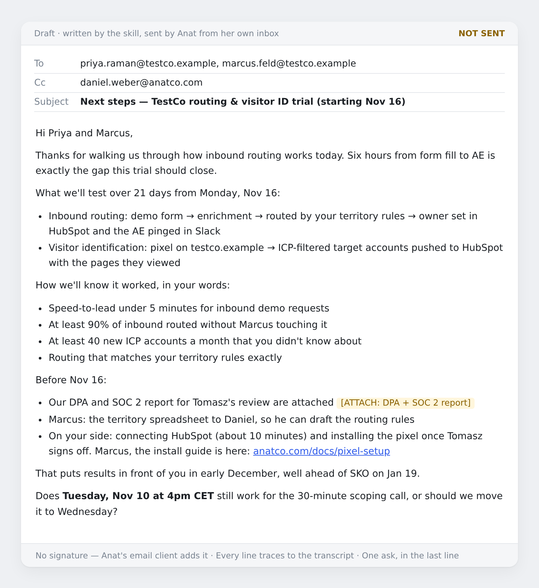

# Test run: Anatco x TestCo demo

One complete run of the four skills on a fictional 30-minute demo call, on Thu, Nov 5, 2026. **TestCo, its people and the meeting are made up.** The HubSpot, Google Sheets and Slack writes were real, into a test workspace; for this repo, the test company's name has been changed to the placeholder "TestCo" and its domain to `testco.example`.

## The input

[`input/meeting-notes.txt`](input/meeting-notes.txt) — Fireflies-style notes: overview, action items and a condensed transcript. Fireflies wasn't connected, so the notes were given to Claude as a file in place of Step 1's pull.

The short version: TestCo (B2B SaaS, ~220 people, Series B in July) routes inbound demo requests by hand and waits about six hours per lead. After the demo, they agreed to a 21-day trial starting Nov 16, gated on an IT security review. They have $35–40K budgeted for 2027 and need it live before their sales kickoff on Jan 19. The CRO, who makes the final budget call, wasn't on the call.

## What came out

| Step | Result |
| --- | --- |
| 2 · Enrich | TestCo wasn't in HubSpot. Estimated ACV ~$35K from the stated budget — above the $20K enterprise line. Tagged **Sales Active**. |
| 3 · Log | First touch: no customer record, no prior meetings, no deal. Row written to the meeting log and read back to verify → [`gtm-meeting-log.csv`](output/gtm-meeting-log.csv) |
| 4 · Memory | Pain, two workflows to test, four success criteria, trial participants and commitments saved as a HubSpot note. First-demo date recorded as Oct 29 (the booking date, not the meeting date). |
| 5 · Score | **Tier A** — Fit 50/50, Intent 50/50 (60 earned, capped). |
| 6 · Stage | Recommended **Qualified To Buy**, not applied. |
| 7 · BANT | **3 of 4** — Authority not met. Deal recommended, as a Yes/No question. |
| 8 · Contacts | 2 attendees + 2 named-but-absent stakeholders created as Sales Qualified Leads, with notes. |
| 9 · Email | Classified **Moving to trial**, flagged ambiguous → [`follow-up-email.md`](output/follow-up-email.md) |
| 10 · Review | Posted to `#post-meeting-review` → [`slack-review-post.md`](output/slack-review-post.md) |
| 11 · Post-send | Waiting on the owner's answers. |
| 12 · LinkedIn | Skipped — no LinkedIn account connected. Logged in the thread. |

All HubSpot changes: [`hubspot-changes.md`](output/hubspot-changes.md)

## The review post

Rendered from the post the skill sent to Slack (full text in [`slack-review-post.md`](output/slack-review-post.md)).

## The email draft

Every line traces to something said in the call — [`follow-up-email.md`](output/follow-up-email.md) maps each one to its transcript timestamp.

## What this run tested well

- **Grounding.** The only link in the email is the one Daniel shared in the call. The DPA and SOC 2 report were promised but have no URL, so the draft uses an `[ATTACH: …]` placeholder instead of inventing one. Pricing was left out because Priya deferred it.
- **Judgment calls are surfaced, not hidden.** Priya asked about cost, which technically matches the "Commercial" category. The skill picked "Moving to trial" and flagged the runner-up. Authority was marked not met because Priya said the CRO decides — someone who counts a VP at a 220-person company as enough would score it 4/4, and the evidence for both readings is in the post.
- **Human gates held.** No deal, stage change or next-step write happened. All three are waiting as Yes/No questions.
- **Gaps are flagged, not filled.** Missing stakeholder emails, no LinkedIn URLs and a blank industry field are listed in the post rather than guessed.

## What to fix next

Screenshots of the real post in Slack showed two formatting issues:

1. **A lost separator.** The `---` after the Stage line didn't render, so "Key Takeaways" runs onto the end of the Stage line. Fix: put a blank line before each `---` in the post template.
2. **`mailto:` prefixes.** Email addresses in the To/CC lines rendered as `mailto:` links. Fix: wrap addresses in backticks, or post them as plain text without auto-linking.

Also worth noting: the post appears under Anat's own name, because the Slack connector posts as the connected user. A dedicated bot account would make skill posts easier to tell apart.
